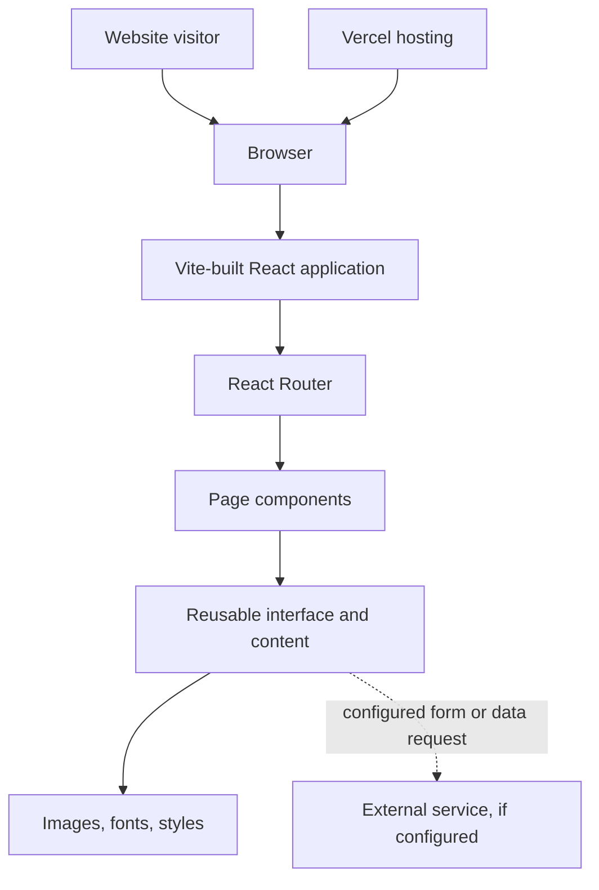

# Kennedy Concrete Website

A React 19 and Vite frontend for the Kennedy Concrete website. The project presents a customer-facing business website and is deployed through Vercel.

**Live site:** https://kennedyconcrete.vercel.app/

## Project overview

The repository uses a modern React single-page application toolchain. Vite provides local development and production bundling, while React renders the interface. The installed dependencies include Bootstrap, AOS, Swiper, React Slick, and related UI libraries for layout, animation, and carousel experiences.

This repository should be treated as the website frontend. Any contact form processing, lead storage, file upload handling, or other server-side operation must be verified against the actual configured service before being described as production-backed.

## Technology

- React 19 and React DOM
- Vite 6
- React Router DOM
- Bootstrap 5
- AOS animation library
- Swiper and React Slick
- ESLint 9
- Vercel deployment configuration

## Local development

### Requirements

- Node.js compatible with Vite 6
- npm

### Install and run

```bash
git clone https://github.com/Brajesh31/Kennedyconcrete.git
cd Kennedyconcrete
npm ci
npm run dev
```

Vite prints the local development URL in the terminal, normally `http://localhost:5173`.

## Available commands

| Command | Description |
| --- | --- |
| `npm run dev` | Start Vite development server |
| `npm run build` | Build optimized static assets |
| `npm run preview` | Preview the production build locally |
| `npm run lint` | Run ESLint |

## Architecture



The exact page and component names should be taken from the current `src/` directory. Keep page composition, shared UI, assets, and any external integration concerns separated as the application evolves.

## Repository layout

- `src/`: React application code and components.
- `public/`: Static assets served directly.
- `index.html`: Browser document shell and metadata.
- `vite.config.js`: Vite configuration.
- `vercel.json`: Hosting and routing configuration.
- `package.json`: Scripts and dependencies.

## Development guidelines

- Keep customer-facing copy accurate and consistent with the business.
- Use responsive layouts and verify mobile, tablet, and desktop widths.
- Use semantic headings, links, buttons, and form labels.
- Ensure keyboard focus is visible and interactive controls have accessible names.
- Optimize large images and avoid layout shifts.
- Keep third-party scripts and dependencies limited to what the site needs.
- Never expose private credentials in frontend code or Vite `VITE_*` variables.

## Quality checks

Run the following before submitting a change:

```bash
npm run lint
npm run build
npm run preview
```

For visual changes, include screenshots and verify the live page at narrow and wide viewport sizes.

## Deployment

The repository includes Vercel configuration. Connect the GitHub repository to the intended Vercel project and use the standard Vite build settings:

- Build command: `npm run build`
- Output directory: `dist`
- Install command: `npm ci`

Verify production routing, asset paths, form destinations, and domain configuration after deployment. A successful frontend build does not verify any external form or backend service.

## Troubleshooting

| Issue | Suggested checks |
| --- | --- |
| Vite command not found | Run `npm ci` from the repository root |
| Build fails | Inspect the first Vite or ESLint error |
| Images do not load | Check whether paths are relative to the correct public or source directory |
| Route refresh returns 404 | Verify Vercel rewrite behavior for client-side routes |
| Animation does not run | Check AOS initialization and element attributes |
| Carousel is broken | Verify the required container structure and initialization |

## Security and contributions

Do not commit secrets, customer information, or private service credentials. Report vulnerabilities privately to the maintainer. Read [CONTRIBUTING.md](CONTRIBUTING.md), [SECURITY.md](SECURITY.md), and [CODE_OF_CONDUCT.md](CODE_OF_CONDUCT.md) before contributing.

## License

See [LICENSE](LICENSE) for the repository's license terms.
