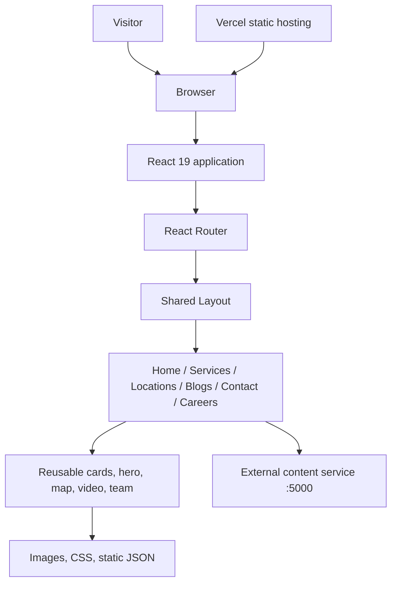

# Architecture

## System overview

Kennedy Concrete is a React single-page website built with Vite. It presents ready-mix concrete and related construction services, location information, company content, blog articles, employment information, and contact details.

The repository is the browser frontend. It does not contain a backend implementation. Some page components request content from a separate local service at `http://localhost:5000`; static blog and service content is also stored in JSON under `public/JSON`.

## Application entry points

- `src/main.jsx` mounts the application in React StrictMode and imports Bootstrap styles and JavaScript.
- `src/App.jsx` defines BrowserRouter routes and global stylesheets.
- `src/Layout/Layout.jsx` composes the shared navigation, page content, and footer.
- `src/Layout/Navbar.jsx` contains desktop and mobile navigation.
- `src/Layout/Footer.jsx` contains shared footer content.

## Route organization

| Route | Page component | Shared layout |
|---|---|---|
| `/` | Home | Yes |
| `/login` | Login | No |
| `/blog` | Blogs | Yes |
| `/blog/page/:page` | BlogCard | Yes |
| `/search` | SearchResults | Yes |
| `/driver-jobs` | Driver | Yes |
| `/concrete-delivery-service` | ConcreteDeliveryService | Yes |
| `/sidewalk` | Sidewalk | Yes |
| `/driveway` | Driveway | Yes |
| `/slab` | Slab | Yes |
| `/cell-fill` | CellFill | Yes |
| `/commercial` | Commercial | Yes |
| `/shotcrete` | ShotCreate | Yes |
| `/decorative-concrete` | DecorativeConcrete | Yes |
| `/construction-building-materials` | Buildingmaterials | Yes |
| `/preferred-contractors` | PreferredContractors | Yes |
| `/instance-quote` | InstantQuote | Yes |
| `/contact-us` | Contact | Yes |

There is no explicit not-found route in the current route table. A request to an unknown path may render an empty route outlet rather than a branded 404 page.

## Page and component areas

- `src/Views/Pages/Home`: homepage sections, including slider, company overview, team, and contact/map content.
- `src/Views/Pages/Service`: delivery, building materials, preferred contractors, and concrete project pages.
- `src/Views/Pages/Locations`: location-specific content currently represented by Orlando.
- `src/Views/Pages/About`: blog and driver job application pages.
- `src/Views/Pages/Homeowners`: instant quote/order information page.
- `src/Views/Pages/Contact`: contact page and location/contact data.
- `src/Views/Components`: reusable hero, cards, map, video, buttons, team, testimonials, and service components.
- `src/assets`: stylesheets, images, and other frontend assets.
- `public/JSON`: static JSON content loaded at runtime.

## Data and integration boundaries

### Static content

- `public/JSON/Blogs.json` supplies blog records.
- `public/JSON/Blogmeta.json` supplies blog metadata labels/icons.
- `public/JSON/Servicebox.json` supplies service benefit cards.

These are public files. Do not place private customer or employee data in them.

### External content API

The inspected home, contact, and instant quote components request data from `http://localhost:5000`:

| Page/component | Request | Expected use |
|---|---|---|
| KennedyConcrete | GET `/about` | Company/about copy and location title |
| ContactMap | GET `/contact` | Contact copy and location phone/email records |
| InstantQuote | GET `/instant` | Instant quote page text |

The backend is not included here. Production hosting must not rely on a visitor's localhost. See [API_INTEGRATIONS.md](API_INTEGRATIONS.md).

## Rendering and styling

Bootstrap is imported globally in `src/main.jsx`. Application styles are imported by `src/App.jsx`, including stylesheets under `src/assets/CSS`. Page and component styles are primarily class-based. AOS, Swiper, React Slick, and Slick Carousel are present as dependencies; check actual component initialization before assuming every installed library is used.

## Important implementation boundaries

- The driver job form currently logs submitted data in the browser and has no active submission endpoint.
- The login route is currently a visual shell without an authentication flow.
- The instant quote page fetches text from a local API and embeds a YouTube video. The visible page does not implement an order or quote transaction.
- Contact details are fetched from a local API. The contact page does not show a submission form in the inspected implementation.
- Social icons in the contact area are rendered from placeholder `#` URLs or as non-link elements.
- The map uses a fixed Google My Maps embed.

Do not describe these as complete production integrations until a backend and end-to-end verification exist.
