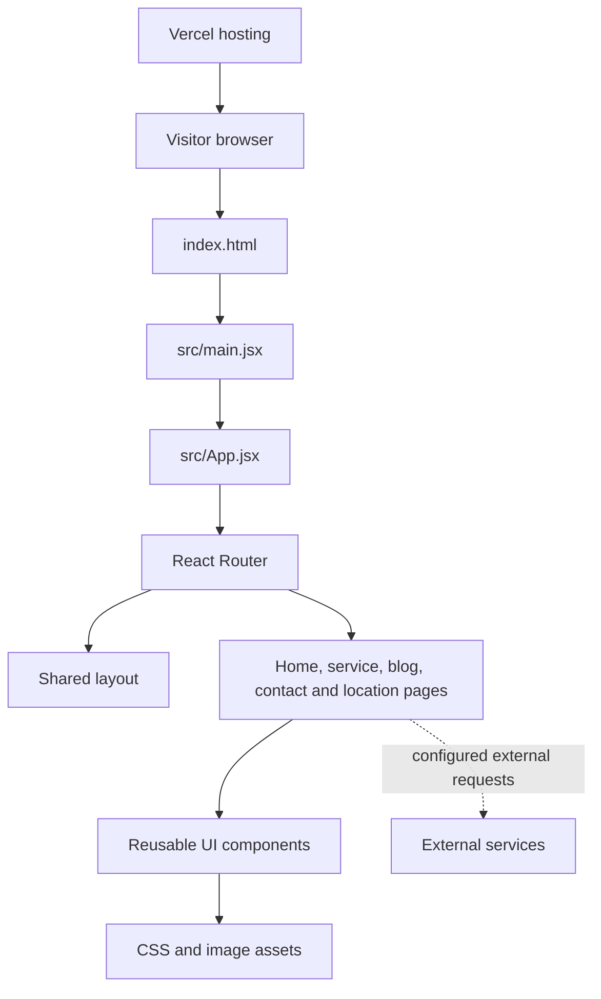

# Architecture

## Overview
Kennedy Concrete is a customer-facing single-page website built with React 19 and Vite 6. The root router in `src/App.jsx` maps URLs to page components and wraps most pages in the shared layout.

## Main areas
- `src/App.jsx`: route declarations.
- `src/Layout/`: shared site layout, navigation and footer.
- `src/Views/Pages/`: route-level page components.
- `src/Views/Components/`: reusable visual components.
- `src/assets/`: styles and images.
- `public/JSON/`: static content data.
- `vercel.json`: single-page application rewrite to `index.html`.

This repository is the frontend. Do not assume that a form, login screen, upload control, or Axios dependency implies a secure production backend. Verify the receiving service and its authorization separately.
